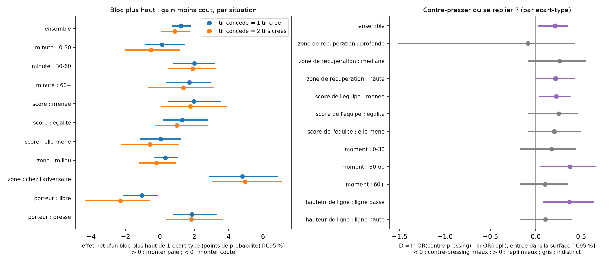

# highline — La ligne haute est un pari sur le porteur

🇫🇷 Français (ce fichier) · 🇬🇧 [English version](README_en.md) — contenu équivalent.

**Faut-il monter sa ligne quand le porteur est libre ?**

> **La ligne haute est un pari sur le porteur : elle rapporte s'il est pressé, elle coûte s'il est libre.**

Analytics Cup 2.0 (SkillCorner × PySport). Données : SkillCorner A-League 2024/25 uniquement (20 matchs, événements dynamiques, Body Pose sur 2 matchs). Aucune donnée externe.

## Question
Monter sa ligne crée des occasions mais expose le dos de la défense. Un staff voit des moyennes ; nous donnons, **situation par situation, le gain, le coût et le bilan**, avec l'incertitude. La fiabilité des positions est un moyen, la décision est le but.

## Méthode
1. **Fiabilité des positions.** Un joueur non détecté a une position extrapolée dont l'erreur croît avec la durée du trou (0,1 m à 0 s, 1,8 m à 5 s, 6 m à 30 s) ; 100 jeux de positions plausibles donnent l'incertitude de la ligne. Les 10 défenseurs de champ ne sont observés que dans 14 % des moments (36 % pour les 4 plus bas) : la ligne est la moyenne des **4 plus bas**.
2. **Ligne résiduelle.** Toutes les 2 s, par équipe qui défend : ligne moins sa valeur habituelle pour la même position du ballon. Retenus : bloc installé (≥ 5 s), balle à plus de 35 m de la **ligne de but**.
3. **Gain et coût.** Gain = tirs de l'équipe dans les 15 s ; coût = tirs adverses ; bilan(w) = gain − w·coût. Points de probabilité par écart-type de ligne, **bootstrap par match**, réplication par moitiés de matchs.
4. **Décision.** Porteur (libre ou pressé, `overall_pressure_start`) × zone × score × minute, cellules d'au moins 400 moments. w* = poids d'un tir concédé au-delà duquel rester bas est préférable.
5. **Leviers.** Contre-pressing (adversaires à moins de 8 m) contre repli ; coût physique (course > 5,5 m/s dans les 8 s après une perte).
6. **Contrôles aux règles écrites avant les résultats (GO / À VOIR / NO-GO).** Alignement tracking/événements, tirs, ligne contre celle du fournisseur, **placebo** (5 % d'intervalles excluant 0 attendus), valeur de possession, observation des 4 plus bas (`docs/rapport_full.txt`).

## Résultats

| Résultat (points par écart-type de ligne, IC 95 %) | Valeur | Statut |
|---|---|---|
| Porteur libre : bilan | −0,90 [−1,81 ; −0,02] | établi |
| Porteur pressé : bilan | +1,43 [+0,52 ; +2,62] | établi |
| Balle chez l'adversaire : bilan | +2,79 [+1,92 ; +3,72] | établi |
| Score, minute à situation égale | −0,18 [−0,83 ; +0,47] ; +0,65 [−0,12 ; +1,42] | non concluant |
| Course de repli rapide (points de %) | +7,6 [+5,5 ; +9,8] | établi |
| Seulement les 26 % de moments où les 4 plus bas sont détectés | bilan +0,35 [−0,55 ; +1,20] | non établi |
| Contrôles | alignement 96 % < 0,5 m ; placebo analytique 5 % ; bootstrap 8–11 % | à lire avec prudence |
| Body Pose (2 matchs) | 86 tirs ; écart min. détectable ≈ 2 | exploratoire |

**Lecture.** La ligne haute rapporte en moyenne, mais cache deux situations opposées : contre un porteur **pressé** elle paie, contre un porteur **libre** elle coûte. Ce qui tranche : la pression sur le porteur, la zone du ballon et, plus faiblement, la minute ; pas le score.

## Perspective exploratoire : Body Pose
Sur 2 matchs, aucun intervalle n'exclut 0 et l'écart minimal détectable dépasse les effets : aucune conclusion, quel que soit le seuil (10, 20 ou 30 cm, test post hoc). Sans pose valide (erreur p90 des épaules ≤ 20 cm), un joueur est exclu, jamais imputé. **Hypothèses pré-enregistrées** (`docs/HYPOTHESES_BODYPOSE.md`) : plus de défenseurs tournés vers leur but, ou d'attaquants face au jeu, annoncent plus de tirs adverses.

## Outil
`docs/outil_decision.html` : page autonome **bilingue FR/EN**. On choisit porteur, zone, score, minute et poids w ; elle affiche gain, coût, bilan, ce qui n'est pas établi, et un moment réel en 3D (`--render3d`).

## Reproduire
```
pip install -r requirements.txt && pip install -e .
python reproduce.py --mode full --check
python reproduce.py --mode fast
pytest
```
Python 3.11, versions figées (`requirements.txt`) ; données du dépôt ouvert SkillCorner. `highline.api` (`docs/API.md`) lit la table de décision sans les données.

## Limites
Association, pas causalité ; **la caméra voit surtout les lignes proches du ballon** (à position de balle égale, ligne 3,8 m [2,6 ; 4,9] plus haute quand les 4 plus bas sont détectés, comparaison plus fine que « vu en entier / ensemble » ; sur ces seuls moments, bilan non établi) ; **l'effet vient surtout des moments que le fournisseur ne juge pas en défense organisée** (restreint aux 77 % organisés, il n'exclut plus 0) ; intervalles bootstrap un peu optimistes (placebo : 8 à 11 % excluant 0 pour 5 % attendus) ; une saison.

## Travaux connexes
Shah (édition 1, `databallpy`), Bekkers & Sahasrabudhe, Choi 2026, Bassek et al. 2025 et Corsie & Swinton 2023 (visibilité et erreur de position), Visual Exploratory Behaviour, VPEP, exPress. Mêmes données : `what-the-camera-saw` (javiersr1996 ; part vue par la caméra, effet de sélection) et `backline` (nowayfootball ; confiance hors caméra), sans lien avec les tirs ni décision ; « The shape of a collective press » (Karayaz) et « He raised his hand » (de Amorim). Nous propageons la fiabilité jusqu'à une décision, distincte de la phase « hors possession » de SkillCorner (18 % de recoupement).

## Bibliothèques et licences
numpy, pandas, scipy, matplotlib, requests (BSD / MIT) ; huggingface_hub (Apache 2.0) ; pytest (MIT). Code MIT (`LICENSE.md`).

## Déclaration d'usage d'outils d'IA
Un assistant d’IA (modèle de langage) a aidé à écrire et relire le code et les textes (français et anglais). La question, les hypothèses et les choix d’analyse ont été arrêtés par l’autrice, qui a exécuté et vérifié l’ensemble sur le jeu de données fourni (tests, `reproduce.py --mode full`) et en assume la responsabilité. Aucune donnée externe n’a été utilisée.
