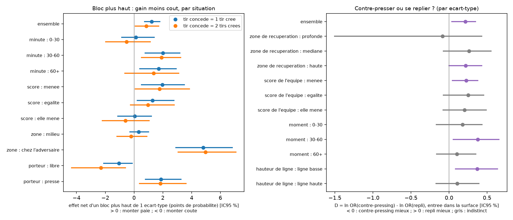

# highline — La ligne haute est un pari sur le porteur

🇫🇷 Français (ce fichier) · 🇬🇧 [English version](README_en.md) — contenu équivalent.

> **La ligne haute est un pari sur le porteur : elle rapporte s'il est pressé, elle coûte s'il est libre.**

Analytics Cup 2.0 (SkillCorner × PySport). Données : SkillCorner A-League 2024/25 uniquement (20 matchs de tracking, événements dynamiques, Body Pose sur 2 matchs). Aucune donnée externe.

## Question
Remonter sa ligne défensive donne des occasions (la balle est récupérée plus haut, l'adversaire est pressé) mais expose le dos de la défense. Quand vaut-il la peine de la monter ? Le staff ne voit que des moyennes ; nous donnons, **situation par situation, le gain, le coût et le bilan**, avec l'incertitude.

## Méthode
1. **Fiabilité des positions.** Un joueur non détecté (`is_detected` faux) a une position extrapolée dont l'erreur croît avec la durée du trou (0,1 m à 0 s, 1,8 m à 5 s, 6 m à 30 s). Nous simulons 100 jeux de positions plausibles par moment pour obtenir l'incertitude de la hauteur de ligne. Les 10 défenseurs de champ ne sont observés que dans 14 % des moments (36 % pour les 4 plus bas) ; nous définissons donc la ligne par les **4 plus bas**.
2. **Ligne résiduelle.** Tous les 2 s, pour chaque équipe qui défend, ligne = moyenne des 4 défenseurs de champ les plus bas, moins ce qu'elle vaut d'habitude pour la même position du ballon (ajustement quadratique par équipe et par match). Moments retenus : bloc installé (≥ 5 s) et balle à plus de 35 m de son but.
3. **Gain et coût.** Gain = tirs de l'équipe dans les 15 s ; coût = tirs adverses dans les 15 s ; bilan(w) = gain − w·coût. Effets en points de probabilité par écart-type de ligne, régression avec erreurs groupées par match, **bootstrap par match**, réplication par moitiés de matchs.
4. **Décision.** Croisement porteur (libre ou pressé, via `overall_pressure_start`) × zone × score × minute, cellules d'au moins 400 moments. Le poids w* = gain/coût indique à partir de quelle aversion au risque la ligne haute cesse de payer.
5. **Leviers.** Contre-pressing (adversaires à moins de 8 m) contre repli (adversaires devant le ballon) ; coût physique (course > 5,5 m/s dans les 8 s après une perte).
6. **Verdicts pré-enregistrés** (GO / À VOIR / NO-GO) écrits en tête des scripts avant calcul.

## Résultats

*(version anglaise : `docs/figure_1_en.png`)*

| Résultat | Valeur [IC95 %] | Statut |
|---|---|---|
| Ensemble (16 336 moments) : gain, coût, bilan | +1,61 [+1,18 ; +2,07] ; +0,38 [−0,03 ; +0,75] ; +1,23 [+0,73 ; +1,79] | établi |
| Porteur libre : bilan | −1,06 [−2,11 ; −0,14] | établi |
| Porteur pressé : bilan | +1,88 [+0,79 ; +3,25] | établi |
| Balle chez l'adversaire : bilan | +4,81 | établi |
| Score, minute (même situation) | interactions non significatives | non concluant |
| Coût physique du repli (points de % par ET) | +7,5 [+5,4 ; +9,5] | établi |
| Contre-pressing vs repli, un joueur déplacé (OR) | 0,99 [0,85 ; 1,11] | non concluant |
| Modèle prédictif hors échantillon (AUC) | 0,63 → 0,64 | NO-GO |

**Lecture.** La ligne haute rapporte en moyenne, mais cette moyenne cache deux situations opposées : contre un porteur **pressé** elle paie, contre un porteur **libre** elle coûte. Ce qui tranche est la pression sur le porteur et la zone du ballon, pas le score ni le moment du match : à situation égale, rien n'établit qu'il faille monter plus quand on mène ou en début de match. Le repli est localement coûteux physiquement.

## Perspective exploratoire : Body Pose
Sur 2 matchs seulement (46 tirs adverses), les orientations de tronc ne permettent aucune conclusion ; l'effet minimal détectable est supérieur à ce qu'on espère. Nous avons **pré-enregistré deux hypothèses** (`docs/HYPOTHESES_BODYPOSE.md`) : plus de défenseurs proches du ballon tournés vers leur but, ou d'attaquants face au jeu, annoncent plus de tirs adverses. Environ 10 matchs suffiraient.

## Outil
`docs/outil_decision.html` (régénéré dans `out/`) : page autonome **bilingue FR/EN** (bouton en haut à droite) (sans serveur) où l'on choisit porteur, zone, score, minute et le poids w ; elle affiche gain, coût, bilan et intervalle, et marque ce qui n'est pas établi. Elle s'appuie sur le paquet Python `highline`.

## Reproduire
```
pip install -e .
python reproduce.py --mode full     # 20 matchs, résultats ci-dessus
python reproduce.py --mode fast     # 4 matchs, test de bon fonctionnement
pytest
```
Les données sont téléchargées depuis le dépôt ouvert SkillCorner (non versionnées). Body Pose est facultatif (`pip install -e .[pose]`).

## Limites
- Association, pas causalité : nous ne savons pas si la ligne haute est choisie ou subie.
- Positions extrapolées : la couche de fiabilité mesure l'incertitude, elle ne la supprime pas.
- Une seule saison, une seule compétition ; écart de score et minute lus sur le dernier événement connu.
- Différence contre-pressing / repli dépendante de l'échelle (écarts-types différents) : seul l'échange d'un joueur est comparable.

## Travaux connexes
Optimisation de positions (Shah, édition 1, `databallpy`), Bekkers & Sahasrabudhe, réseaux défensifs (JeremyBetz), Choi 2026, Visual Exploratory Behaviour, VPEP, exPress. Nous nous distinguons de la phase « hors possession » de SkillCorner (accord de 18 % avec notre contre-pressing « direct ») en chiffrant gain, coût et incertitude par situation.

## Bibliothèques et licences
numpy, pandas, scipy, matplotlib, requests (BSD / MIT) ; huggingface_hub (Apache 2.0, facultatif) ; pytest (MIT). Code sous licence MIT (`LICENSE.md`).

## Déclaration d'usage d'outils d'IA
<!-- À COMPLÉTER PAR L'AUTRICE : décision personnelle. Les règles ne traitent pas ce point. -->
