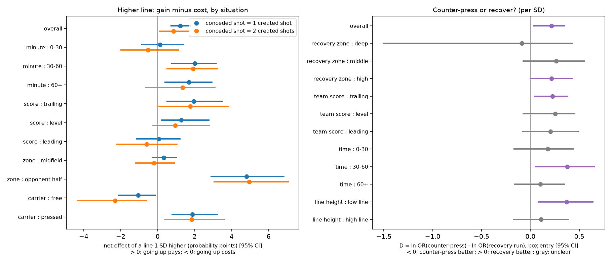

# highline — The high line is a bet on the ball carrier

🇬🇧 English (this file) · 🇫🇷 [Version française](README.md) — equivalent content.

> **The high defensive line is a bet on the ball carrier: it pays if he is pressed, it costs if he is free.**

Analytics Cup 2.0 (SkillCorner × PySport). Data: SkillCorner A-League 2024/25 only (20 tracking matches, dynamic events, Body Pose on 2 matches). No external data.

## Question
Pushing the defensive line up wins the ball higher (the opponent is pressed) but exposes the space behind. When is it worth it? Staffs see averages; we give, **situation by situation, the gain, the cost and the net balance**, with uncertainty.

## Method
1. **Position reliability.** An undetected player (`is_detected` false) has an extrapolated position whose error grows with gap length (0.1 m at 0 s, 1.8 m at 5 s, 6 m at 30 s). We simulate 100 plausible position sets per moment to get the uncertainty of line height. All 10 outfield defenders are observed in only 14 % of moments (36 % for the 4 deepest), so the line is defined by the **4 deepest**.
2. **Residual line.** Every 2 s, for each defending team: line = mean of the 4 deepest outfield defenders, minus its usual value for the same ball position (quadratic fit per team and match). Kept: settled block (≥ 5 s) and ball more than 35 m from its own goal.
3. **Gain and cost.** Gain = own shots within 15 s; cost = opponent shots within 15 s; net(w) = gain − w·cost. Effects in probability points per standard deviation of line, regression with match-clustered errors, **match-level bootstrap**, split-half replication.
4. **Decision.** Carrier (free or pressed, from `overall_pressure_start`) × zone × score × minute, cells of at least 400 moments. The weight w* = gain/cost tells from which risk aversion the high line stops paying.
5. **Levers.** Counter-press (opponents within 8 m) versus recovery run (opponents ahead of the ball); physical cost (sprinting > 5.5 m/s within 8 s after a loss).
6. **Pre-registered verdicts** (GO / MAYBE / NO-GO) written in the script headers before computing.

## Results

*(French version: `docs/figure_1.png`)*

| Result | Value [95% CI] | Status |
|---|---|---|
| Overall (16,336 moments): gain, cost, net | +1.61 [+1.18; +2.07]; +0.38 [−0.03; +0.75]; +1.23 [+0.73; +1.79] | established |
| Free carrier: net | −1.06 [−2.11; −0.14] | established |
| Pressed carrier: net | +1.88 [+0.79; +3.25] | established |
| Ball in opponent half: net | +4.81 | established |
| Score, minute (same situation) | interactions not significant | inconclusive |
| Physical cost of recovering (% points per SD) | +7.5 [+5.4; +9.5] | established |
| Counter-press vs recovery, one player swapped (OR) | 0.99 [0.85; 1.11] | inconclusive |
| Out-of-sample predictive model (AUC) | 0.63 → 0.64 | NO-GO |

**Reading.** On average the high line pays, but that average hides two opposite situations: against a **pressed** carrier it pays, against a **free** carrier it costs. What decides is pressure on the carrier and ball zone, not score or match time: for equal situations, nothing establishes that a team should go higher when leading or early on. Recovering is locally costly in physical terms.

## Exploratory perspective: Body Pose
With only 2 matches (46 opponent shots), trunk orientations allow no conclusion; the minimum detectable effect is large. We **pre-registered two hypotheses** (`docs/HYPOTHESES_BODYPOSE.md`): more near-ball defenders turned toward their own goal, or more near-ball attackers facing forward, precede more opponent shots. About 10 matches would suffice.

## Tool
`docs/outil_decision.html` (regenerated in `out/`): a standalone page (no server), **bilingual FR/EN** (button top right). Pick carrier, zone, score, minute and weight w; it shows gain, cost, net and interval, and flags what is not established. It is built on the Python package `highline`.

## Reproduce
```
pip install -e .
python reproduce.py --mode full     # 20 matches, results above
python reproduce.py --mode fast     # 4 matches, smoke test
pytest
```
Data are downloaded from SkillCorner's open repository (not versioned). Body Pose is included by default: the first run downloads the pose data (about 600 MB per match, cached).

## Limits
- Association, not causation: we do not know whether the high line is chosen or forced.
- Extrapolated positions: the reliability layer measures uncertainty, it does not remove it.
- One season, one competition; score and minute are read from the last known event.
- Counter-press vs recovery comparison depends on scale (different SDs): only the one-player swap is comparable.

## Related work
Position optimisation (Shah, edition 1, `databallpy`), Bekkers & Sahasrabudhe, defensive networks (JeremyBetz), Choi 2026, Visual Exploratory Behaviour, VPEP, exPress. We differ from SkillCorner's out-of-possession phases (18 % agreement with our “direct” counter-press) by quantifying gain, cost and uncertainty per situation.

## Libraries and licences
numpy, pandas, scipy, matplotlib, requests (BSD / MIT); huggingface_hub (Apache 2.0, optional); pytest (MIT). Code under MIT licence (`LICENSE.md`).

## AI-tool use declaration
An AI assistant (language model) helped write and review the code and the texts (French and English). The question, hypotheses and analysis choices were decided by the author, who ran and checked everything on the provided dataset (tests, `reproduce.py --mode full`) and takes responsibility for it. No external data was used.
